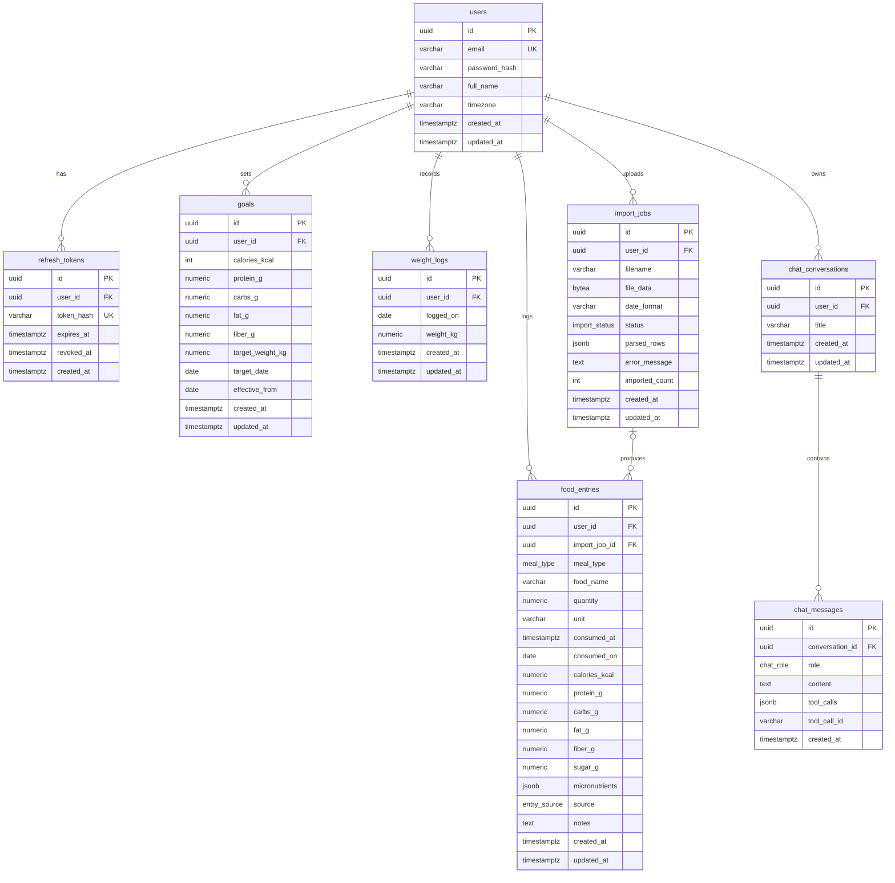

# Personal Calorie Tracker — Backend Design

This document describes the backend architecture, database design, and the logic behind every feature.
It is the reference for implementation; the README covers setup and running the app.

## Contents

1. [Tech Stack](#1-tech-stack)
2. [Architecture](#2-architecture)
3. [Project Structure](#3-project-structure)
4. [Cross-Cutting Concerns](#4-cross-cutting-concerns)
5. [Database Design](#5-database-design)
6. [Features](#6-features)
   - [6.1 Auth & Multi-User](#61-auth--multi-user)
   - [6.2 Goal Setting & Weight Tracking](#62-goal-setting--weight-tracking)
   - [6.3 Meal Entry](#63-meal-entry)
   - [6.4 Time-Range Listing](#64-time-range-listing)
   - [6.5 Nutrition Reports](#65-nutrition-reports)
   - [6.6 AI Calorie Extraction](#66-ai-calorie-extraction)
   - [6.7 Conversational Chat](#67-conversational-chat)
   - [6.8 PDF Bulk Import](#68-pdf-bulk-import)
   - [6.9 Health Check](#69-health-check)
7. [Redis Usage](#7-redis-usage)
8. [API Reference Summary](#8-api-reference-summary)
9. [Deployment (Fly.io)](#9-deployment-flyio)
10. [Assumptions](#10-assumptions)

---

## 1. Tech Stack

| Concern | Choice |
|---|---|
| Framework | FastAPI (async) |
| ORM / DB driver | SQLAlchemy 2.0 (async) + asyncpg |
| Database | PostgreSQL |
| Migrations | Alembic |
| Validation / settings | Pydantic v2, pydantic-settings |
| Auth | PyJWT (access tokens), argon2 password hashing via `pwdlib` |
| Cache / queue | Redis + `arq` (async job queue) |
| AI | LangChain (OpenAI chat models) — vision, structured outputs, tool-calling agents |
| PDF parsing | `pdfplumber` |
| Image processing | Pillow |
| Testing / linting | pytest + httpx, ruff |

---

## 2. Architecture

### 2.1 Layers

Every request passes through the same layers. Each layer has one responsibility:

```
HTTP request
   │
   ▼
Endpoint (api/v1/endpoints)   – parse & validate input (Pydantic), resolve current user, call service
   │
   ▼
Service (services/)           – business rules, orchestration, transactions; no HTTP knowledge
   │
   ▼
Repository (repositories/)    – SQL queries only; every query scoped by user_id
   │
   ▼
PostgreSQL
```

- **Endpoints are thin.** No business logic; they translate HTTP to a service call.
- **Services are reusable.** The REST API, the chat tools, and the PDF worker all call the same services, so business rules exist in exactly one place.
- **Repositories never trust callers for ownership.** Every method requires `user_id`.
- **Integrations** (`integrations/`) wrap external systems (LLM via LangChain, PDF parsing) so they can be mocked in tests and swapped without touching services. Domain rules stay in services; LangChain is used only for model orchestration.

### 2.2 Runtime components

```
                ┌──────────────┐
  Browser ────► │  frontend    │  nginx: serves SPA, proxies /api → backend
                └──────┬───────┘
                       │ (private network)
                ┌──────▼───────┐        ┌────────────────────┐
                │  backend     │ ─────► │ OpenAI (via        │
                │  (FastAPI +  │        │ LangChain)         │
                │   LangChain) │        └────────────────────┘
                └──┬───────┬───┘
                   │       │ enqueue jobs / rate limits
         ┌─────────▼─┐   ┌─▼───────┐
         │ PostgreSQL│   │  Redis  │
         └─────────▲─┘   └─┬───────┘
                   │       │ consume jobs
                ┌──┴───────▼───┐
                │  worker (arq)│ ─────► OpenAI via LangChain
                │              │        (PDF LLM fallback)
                └──────────────┘
```

---

## 3. Project Structure

```
backend/
  app/
    main.py                     # app factory: middleware, exception handlers, router mounting
    nutrients.py                # nutrient registry (code, name, unit, daily value)

    core/
      config.py                 # Settings from env vars; postgres:// URL scheme fix
      security.py               # password hashing, JWT create/verify, refresh token generation
      errors.py                 # AppError hierarchy + exception handlers
      redis.py                  # Redis connection pool
      rate_limit.py             # rate_limit() dependency
      time.py                   # timezone helpers (to_local_date, today_for)
      logging.py                # structured logging, request id

    db/
      base.py                   # declarative Base, common columns (id, created_at, updated_at)
      session.py                # async engine, get_db session dependency

    models/                     # SQLAlchemy models, one file per aggregate
      user.py  refresh_token.py  goal.py  weight_log.py
      food_entry.py  import_job.py  chat.py

    schemas/                    # Pydantic request/response models
      common.py                 # Page[T], PaginationParams, ErrorResponse
      auth.py  user.py  goal.py  weight_log.py  entry.py
      report.py  ai.py  imports.py  chat.py

    repositories/               # DB access only
      base.py                   # generic paginate() helper
      user_repo.py  token_repo.py  goal_repo.py  weight_log_repo.py
      entry_repo.py  report_repo.py  import_repo.py  chat_repo.py

    services/                   # business logic
      auth_service.py  user_service.py  goal_service.py  weight_log_service.py
      entry_service.py  report_service.py  ai_service.py
      import_service.py  chat_service.py

    integrations/
      llm.py                    # shared LangChain ChatOpenAI factory: timeouts, retries, error mapping; injectable for tests
      vision.py                 # vision prompts + with_structured_output(ImageAnalysis)
      pdf_parser.py             # pdfplumber table extraction + column mapping
      pdf_llm_fallback.py       # LangChain structured-output row extraction for messy PDFs

    chat/
      tools.py                  # LangChain tools: Pydantic args, handlers → services
      agent.py                  # tool-calling agent loop (max iterations)
      prompts.py                # system prompt

    workers/
      main.py                   # arq WorkerSettings
      import_tasks.py           # process_pdf_import job

    api/
      deps.py                   # get_db, get_current_user, pagination params
      health.py                 # GET /health (mounted at root, outside /api/v1)
      v1/
        router.py               # aggregates all endpoint routers into api_router
        endpoints/
          auth.py  users.py  goals.py  weight_logs.py  entries.py
          reports.py  ai.py  imports.py  chat.py  meta.py

  alembic/                      # migrations
  alembic.ini
  tests/
    unit/                       # services, parsers, nutrient validation
    api/                        # endpoint tests against a test database
  Dockerfile
  fly.toml
  requirements.txt              # pinned runtime dependencies
  requirements-dev.txt          # runtime + test/lint tools
  pyproject.toml                # tool settings (ruff, pytest)
```

### Router composition

Each endpoint module defines an `APIRouter()` without a prefix. Prefixes and tags are assigned in one place, `api/v1/router.py`:

```python
api_router = APIRouter()
api_router.include_router(auth.router, prefix="/auth", tags=["auth"])
api_router.include_router(entries.router, prefix="/entries", tags=["entries"])
# ... one line per module
```

`main.py` mounts `api_router` at `/api/v1` and the health router at the root.

---

## 4. Cross-Cutting Concerns

### 4.1 Configuration (`core/config.py`)

All configuration comes from environment variables via `pydantic-settings`, validated at startup (the app fails fast on missing/invalid config).

| Variable | Purpose |
|---|---|
| `DATABASE_URL` | Postgres URL. `postgresql://` and `postgres://` are rewritten to `postgresql+asyncpg://`. |
| `REDIS_URL` | Redis URL |
| `JWT_SECRET` | Access token signing key |
| `ACCESS_TOKEN_TTL_MINUTES` | Default 15 |
| `REFRESH_TOKEN_TTL_DAYS` | Default 7 |
| `OPENAI_API_KEY` | OpenAI key |
| `OPENAI_VISION_MODEL`, `OPENAI_CHAT_MODEL` | Model names, configurable |
| `CORS_ORIGINS` | Local development only (production is same-origin) |
| `ENVIRONMENT` | `local` / `production` (controls cookie `Secure` flag, docs exposure) |

### 4.2 Error handling (`core/errors.py`)

Services raise typed domain errors; a single handler converts them to a consistent response.

```
AppError(code, message, status_code, details)
 ├── NotFoundError          404
 ├── ConflictError          409
 ├── AuthError              401
 ├── PermissionError        403
 ├── BusinessRuleError      422
 ├── RateLimitError         429  (adds Retry-After header)
 └── ExternalServiceError   502 / 503 / 504
```

**Error envelope** (used for every error, including Pydantic validation errors):

```json
{
  "error": {
    "code": "VALIDATION_ERROR",
    "message": "Request validation failed",
    "details": [{ "field": "quantity", "message": "must be greater than 0" }]
  }
}
```

- `RequestValidationError` is reshaped into this envelope so the frontend handles one format.
- Unhandled exceptions are logged with the request id and returned as a generic `500 INTERNAL_ERROR` — internals are never leaked.

### 4.3 Pagination (`schemas/common.py`, `repositories/base.py`)

- `PaginationParams` dependency: `page` (≥ 1, default 1), `page_size` (1–100, default 20).
- Generic `paginate(session, stmt, params)` runs the query with `LIMIT/OFFSET` plus a `COUNT(*)` and returns `Page[T]`.

```json
{ "items": [], "page": 1, "page_size": 20, "total": 134, "total_pages": 7 }
```

Offset pagination is chosen because per-user datasets are small and the UI needs page numbers. All list queries use a deterministic order (e.g. `consumed_at DESC, id DESC`) so pages are stable.

### 4.4 Timezones (`core/time.py`)

A "day" always means the **user's local day**. Each user stores an IANA timezone (e.g. `Asia/Kolkata`).

- `to_local_date(dt, tz)` — converts a UTC timestamp to the user's local date.
- `today_for(user)` — the current local date for the user.

### 4.5 Nutrient registry (`nutrients.py`)

A single source of truth for supported micronutrients:

```python
NutrientDef(code="vitamin_c_mg", name="Vitamin C", unit="mg", daily_value=90)
```

Used for: validating entry micronutrients, computing % daily value in reports, building AI/PDF prompts, PDF column mapping, and `GET /api/v1/nutrients` (frontend labels and units).

Initial set: vitamins A, C, D, E, K, B6, B12, folate; calcium, iron, magnesium, potassium, sodium, zinc; cholesterol.

### 4.6 Database sessions & transactions

- `get_db` yields one `AsyncSession` per request.
- Services own the transaction boundary (`commit` on success); the session is rolled back on any exception.
- Multi-row operations (PDF import confirm) run in a single transaction — all or nothing.

### 4.7 Middleware

- **Request ID** — generated per request, returned in `X-Request-ID`, included in logs.
- **Access logging** — method, path, status, duration.
- **CORS** — enabled only in local development.

---

## 5. Database Design

### 5.1 Entity-relationship diagram



### 5.2 Enum types

| Enum | Values |
|---|---|
| `meal_type` | `breakfast`, `lunch`, `dinner`, `snacks` |
| `entry_source` | `manual`, `ai_image`, `pdf_import`, `chat` |
| `import_status` | `pending`, `processing`, `preview_ready`, `completed`, `failed` |
| `chat_role` | `user`, `assistant`, `tool` |

`unit` is validated in the application (`g`, `ml`, `piece`, `serving`, `cup`, `tbsp`, `tsp`) rather than as a DB enum, so new units don't require a migration.

### 5.3 Tables

All primary keys are UUIDs (non-guessable, safe to expose in URLs). All timestamps are `timestamptz` stored in UTC. Foreign keys to `users` use `ON DELETE CASCADE` so deleting a user removes all their data.

#### `users`

| Column | Type | Constraints | Notes |
|---|---|---|---|
| id | uuid | PK | |
| email | varchar(255) | NOT NULL, UNIQUE | Stored lowercased |
| password_hash | varchar(255) | NOT NULL | argon2 |
| full_name | varchar(100) | NOT NULL | |
| timezone | varchar(64) | NOT NULL, default `'UTC'` | IANA name, validated in app |
| created_at | timestamptz | NOT NULL, default now() | |
| updated_at | timestamptz | NOT NULL, default now() | |

#### `refresh_tokens`

| Column | Type | Constraints | Notes |
|---|---|---|---|
| id | uuid | PK | |
| user_id | uuid | FK → users.id, NOT NULL | |
| token_hash | varchar(64) | NOT NULL, UNIQUE | SHA-256 of the raw token; raw token never stored |
| expires_at | timestamptz | NOT NULL | |
| revoked_at | timestamptz | NULL | Set on rotation/logout |
| created_at | timestamptz | NOT NULL | |

Indexes: `(user_id)`.

#### `goals`

| Column | Type | Constraints | Notes |
|---|---|---|---|
| id | uuid | PK | |
| user_id | uuid | FK → users.id, NOT NULL | |
| calories_kcal | integer | NOT NULL, CHECK 800–10000 | |
| protein_g | numeric(7,2) | NOT NULL, CHECK ≥ 0 | |
| carbs_g | numeric(7,2) | NOT NULL, CHECK ≥ 0 | |
| fat_g | numeric(7,2) | NOT NULL, CHECK ≥ 0 | |
| fiber_g | numeric(7,2) | NULL, CHECK ≥ 0 | |
| target_weight_kg | numeric(5,2) | NULL, CHECK 20–400 | |
| target_date | date | NULL | |
| effective_from | date | NOT NULL | Local date this version starts applying |
| created_at / updated_at | timestamptz | NOT NULL | |

Constraints: `UNIQUE (user_id, effective_from)`.
Indexes: covered by the unique constraint (`user_id, effective_from`).

#### `weight_logs`

| Column | Type | Constraints | Notes |
|---|---|---|---|
| id | uuid | PK | |
| user_id | uuid | FK → users.id, NOT NULL | |
| logged_on | date | NOT NULL | Local date |
| weight_kg | numeric(5,2) | NOT NULL, CHECK 20–400 | |
| created_at / updated_at | timestamptz | NOT NULL | |

Constraints: `UNIQUE (user_id, logged_on)` — one weight per day (upsert).

#### `food_entries`

| Column | Type | Constraints | Notes |
|---|---|---|---|
| id | uuid | PK | |
| user_id | uuid | FK → users.id, NOT NULL | |
| import_job_id | uuid | FK → import_jobs.id, NULL, ON DELETE SET NULL | Set for PDF imports |
| meal_type | meal_type | NOT NULL | |
| food_name | varchar(200) | NOT NULL | |
| quantity | numeric(8,2) | NOT NULL, CHECK > 0 | |
| unit | varchar(20) | NOT NULL | |
| consumed_at | timestamptz | NOT NULL | When the food was eaten |
| consumed_on | date | NOT NULL | Local date derived from `consumed_at` + user timezone |
| calories_kcal | numeric(7,2) | NOT NULL, CHECK ≥ 0 | |
| protein_g | numeric(7,2) | NOT NULL, default 0, CHECK ≥ 0 | |
| carbs_g | numeric(7,2) | NOT NULL, default 0, CHECK ≥ 0 | |
| fat_g | numeric(7,2) | NOT NULL, default 0, CHECK ≥ 0 | |
| fiber_g | numeric(7,2) | NULL, CHECK ≥ 0 | |
| sugar_g | numeric(7,2) | NULL, CHECK ≥ 0 | |
| micronutrients | jsonb | NOT NULL, default `'{}'` | Keys validated against the nutrient registry |
| source | entry_source | NOT NULL, default `manual` | |
| notes | text | NULL | |
| created_at / updated_at | timestamptz | NOT NULL | |

Indexes:
- `(user_id, consumed_on)` — time-range listing and all reports.
- `(user_id, meal_type, consumed_on)` — listing filtered by meal type.
- `(user_id, lower(food_name))` — recent foods lookup.

#### `import_jobs`

| Column | Type | Constraints | Notes |
|---|---|---|---|
| id | uuid | PK | |
| user_id | uuid | FK → users.id, NOT NULL | |
| filename | varchar(255) | NOT NULL | Original name, for display |
| file_data | bytea | NULL | Raw PDF; cleared after processing |
| date_format | varchar(3) | NOT NULL, default `'DMY'` | `DMY` or `MDY` |
| status | import_status | NOT NULL, default `pending` | |
| parsed_rows | jsonb | NULL | `[{row_number, data, status, errors}]` |
| error_message | text | NULL | Set when status = `failed` |
| imported_count | integer | NOT NULL, default 0 | |
| created_at / updated_at | timestamptz | NOT NULL | |

Indexes: `(user_id, created_at DESC)`.

#### `chat_conversations`

| Column | Type | Constraints | Notes |
|---|---|---|---|
| id | uuid | PK | |
| user_id | uuid | FK → users.id, NOT NULL | |
| title | varchar(200) | NOT NULL | Derived from the first user message |
| created_at / updated_at | timestamptz | NOT NULL | `updated_at` bumped on each message |

Indexes: `(user_id, updated_at DESC)`.

#### `chat_messages`

| Column | Type | Constraints | Notes |
|---|---|---|---|
| id | uuid | PK | |
| conversation_id | uuid | FK → chat_conversations.id, NOT NULL, ON DELETE CASCADE | |
| role | chat_role | NOT NULL | |
| content | text | NULL | NULL for assistant messages that only contain tool calls |
| tool_calls | jsonb | NULL | Tool calls requested by the assistant |
| tool_call_id | varchar(100) | NULL | For `tool` role messages: which call this answers |
| created_at | timestamptz | NOT NULL | |

Indexes: `(conversation_id, created_at)`.

### 5.4 Key design decisions

| Decision | Reasoning |
|---|---|
| **Separate `consumed_on` column** | "Today" depends on the user's timezone. Computing the local date at write time makes date filters and daily grouping simple, correct, and index-friendly. Recomputed whenever `consumed_at` changes. |
| **Versioned goals (`effective_from`)** | Goals change over time. Goal-vs-actual for a past day must compare against the goal that applied *on that day*, not today's goal. |
| **Micronutrients as JSONB + registry** | Micronutrients are open-ended and sparse. JSONB avoids ~20 mostly-NULL columns or a join-heavy EAV table, accepts data from manual/AI/PDF/chat sources uniformly, and is still aggregatable in SQL (`jsonb_each_text`). Integrity is enforced by validating keys and values against the registry. |
| **No food catalog; entries are snapshots** | Each entry stores its own nutrition values, so history never changes retroactively and AI/PDF/chat simply create entries. "Recent foods" (from past entries) provides quick re-logging. |
| **Macros as columns, not JSONB** | Calories and macros are always present and heavily queried in reports, so they get typed columns with CHECK constraints. |
| **`source` column** | Records provenance (manual, AI, PDF, chat) for auditing, debugging, and UI badges. |
| **UUID primary keys** | Non-sequential IDs don't reveal data volume and can't be enumerated. |
| **Refresh tokens hashed** | A database leak doesn't expose usable tokens. |
| **PDF bytes in Postgres, not disk/Redis** | The API and worker do not share a disk. Postgres is durable, whereas Redis may evict or lose data. Bytes are cleared after processing. |

---

## 6. Features

### 6.1 Auth & Multi-User

**Files:** `endpoints/auth.py`, `endpoints/users.py`, `services/auth_service.py`, `services/user_service.py`, `core/security.py`, `repositories/user_repo.py`, `repositories/token_repo.py`

**Endpoints**

| Method | Path | Description |
|---|---|---|
| POST | `/auth/register` | Create account |
| POST | `/auth/login` | Issue access + refresh token |
| POST | `/auth/refresh` | Rotate refresh token, issue new access token |
| POST | `/auth/logout` | Revoke refresh token |
| GET | `/users/me` | Current profile |
| PATCH | `/users/me` | Update name / timezone |

**Register**
1. Validate: `EmailStr` (lowercased), password ≥ 8 chars with at least one letter and one digit, `full_name` 1–100 chars, `timezone` must be a valid IANA zone.
2. Email already exists → `409 EMAIL_ALREADY_REGISTERED`.
3. Hash the password (argon2) and create the user. Returns the user profile (no tokens; the client logs in next).

**Login**
1. Look up user by email; verify the password hash.
2. Wrong email **and** wrong password both return the same `401 INVALID_CREDENTIALS` (prevents account enumeration).
3. Issue tokens:
   - **Access token** — JWT, 15 min, claims `sub=user_id`, `type=access`, `exp`. Returned in the response body; the frontend keeps it in memory only.
   - **Refresh token** — 256-bit random string, 7 days. Sent as an `httpOnly`, `Secure`, `SameSite=Strict` cookie scoped to `/api/v1/auth`. Only its SHA-256 hash is stored.

**Refresh**
1. Read the cookie, hash it, look it up. Missing / expired / revoked → `401`.
2. **Rotation:** revoke the presented token, issue a new refresh token and access token.
3. **Reuse detection:** if an already-revoked token is presented, it was likely stolen — revoke all of the user's tokens and return `401`.

**Logout:** revoke the current refresh token and clear the cookie.

**Route protection:** `get_current_user` (in `api/deps.py`) decodes the bearer JWT, checks `type=access`, and loads the user. Invalid/expired → `401`. The frontend interceptor calls `/auth/refresh` once and retries.

**Data isolation**
- Every repository method takes `user_id` and filters by it.
- Accessing another user's resource by id returns **404, not 403**, so the existence of other users' data is not revealed.
- In chat, `user_id` is injected from the auth context — never from LLM output.

**Redis:** login rate limit — 5 attempts per minute per `(IP, email)`.

---

### 6.2 Goal Setting & Weight Tracking

**Files:** `endpoints/goals.py`, `endpoints/weight_logs.py`, `services/goal_service.py`, `services/weight_log_service.py`, `repositories/goal_repo.py`, `repositories/weight_log_repo.py`

**Endpoints**

| Method | Path | Description |
|---|---|---|
| GET | `/goals/current` | Goal version in effect today |
| GET | `/goals` | Goal history (paginated) |
| POST | `/goals` | Create a new goal version |
| PATCH | `/goals/{id}` | Edit a version |
| DELETE | `/goals/{id}` | Delete a version |
| POST | `/weight-logs` | Log weight for a day (upsert) |
| GET | `/weight-logs` | Weight history (paginated, filterable by date range) |
| DELETE | `/weight-logs/{id}` | Delete a weight log |

**Goal versioning logic**
- `POST /goals` creates a version with `effective_from` (defaults to the user's local today). If a version already exists for that date it is replaced (upsert) — changing goals twice in one day yields one version.
- **Current goal** = latest version with `effective_from ≤ today` (query below).
- No goal set → `404 GOAL_NOT_SET` (frontend shows onboarding).

```sql
SELECT * FROM goals
WHERE user_id = :uid AND effective_from <= :today
ORDER BY effective_from DESC LIMIT 1;
```

**Goal lookup for date ranges** (used by reports)
- `goal_service.get_goals_for_range(user_id, start, end)` loads the version in effect at `start` plus all versions with `effective_from` in `(start, end]`, then maps each day to the version in effect on that day.

**Validation**
- Calories 800–10000; macros ≥ 0; `target_weight_kg` 20–400; `target_date` must be in the future.
- **Macro consistency warning:** if `protein×4 + carbs×4 + fat×9` differs from `calories_kcal` by more than 15%, the response includes a `warnings` array. This is a soft warning, not an error.

**Weight logs**
- One entry per local day; logging again the same day updates it.
- **Weight progress** (included in `GET /goals/current` when a target weight exists):
  - Start weight = first log on/after the goal's `effective_from`.
  - Current weight = latest log.
  - Progress % = `(start − current) / (start − target) × 100`, clamped to 0–100.

---

### 6.3 Meal Entry

**Files:** `endpoints/entries.py`, `services/entry_service.py`, `repositories/entry_repo.py`, `schemas/entry.py`, `nutrients.py`

**Endpoints**

| Method | Path | Description |
|---|---|---|
| POST | `/entries` | Create an entry |
| GET | `/entries/{id}` | Get one entry |
| PATCH | `/entries/{id}` | Partial update |
| DELETE | `/entries/{id}` | Delete (204) |
| GET | `/entries/recent` | Distinct recently logged foods (paginated) |

**Validation (`FoodEntryCreate`)**

| Field | Rule |
|---|---|
| `meal_type` | `breakfast` / `lunch` / `dinner` / `snacks` |
| `food_name` | 1–200 chars, trimmed |
| `quantity` | > 0 |
| `unit` | `g`, `ml`, `piece`, `serving`, `cup`, `tbsp`, `tsp` |
| `consumed_at` | Optional (defaults to now); cannot be in the future (5-minute clock-skew tolerance) |
| `calories_kcal` | 0–10000 |
| `protein_g`, `carbs_g`, `fat_g`, `fiber_g`, `sugar_g` | ≥ 0, ≤ 1000 |
| `micronutrients` | Every key must exist in the registry; values ≥ 0. Unknown key → `422` naming the key |
| `source` | Client may only send `manual` or `ai_image` |

**Create logic**
1. Validate the payload.
2. Compute `consumed_on = to_local_date(consumed_at, user.timezone)`.
3. Set `source` (client-provided `manual`/`ai_image`; `chat` and `pdf_import` are set internally by those features).
4. Persist and return the entry.

**Update logic**
- Same validation, all fields optional.
- If `consumed_at` changes, `consumed_on` is recomputed.
- Entry not found or owned by another user → `404 ENTRY_NOT_FOUND`.

**Recent foods**
- Returns the most recent entry per distinct food name, so the user can re-log in one click.
- The result is then ordered by `consumed_at DESC` and paginated.

```sql
SELECT DISTINCT ON (lower(food_name)) *
FROM food_entries
WHERE user_id = :uid
ORDER BY lower(food_name), consumed_at DESC;
```

---

### 6.4 Time-Range Listing

**Endpoint:** `GET /entries`

| Query param | Rule |
|---|---|
| `start_date` | Local date, optional (default: 6 days before today) |
| `end_date` | Local date, optional (default: today) |
| `meal_type` | Optional, repeatable (`?meal_type=lunch&meal_type=dinner`) |
| `page`, `page_size` | Standard pagination |

**Logic**
1. Validate `start_date ≤ end_date` (else `422 INVALID_DATE_RANGE`); range ≤ 366 days.
2. Filter by user, date range, and optional meal types (query below).
3. Return `Page[FoodEntryRead]` via `paginate()`.

```sql
WHERE user_id = :uid
  AND consumed_on BETWEEN :start AND :end
  [AND meal_type = ANY(:meal_types)]
ORDER BY consumed_at DESC, id DESC
```

**Indexes used:** `(user_id, consumed_on)`; `(user_id, meal_type, consumed_on)` when filtering by meal type.

---

### 6.5 Nutrition Reports

**Files:** `endpoints/reports.py`, `services/report_service.py`, `repositories/report_repo.py`, `schemas/report.py`

All aggregation runs in PostgreSQL; the frontend only renders.

**Common validation:** `start_date ≤ end_date`, range ≤ 92 days; `group_by ∈ {day, week}`.

#### Daily summary — `GET /reports/daily-summary?date=`
- Totals (calories, macros) for the day, broken down by meal type.
- The goal in effect that day and remaining amounts (`goal − actual`).
- Powers the dashboard.

#### Weekly calorie trend — `GET /reports/calorie-trend?start_date&end_date`
- Uses `generate_series` so days without entries appear as 0 rather than gaps.
- Each point includes `goal_calories` for that day (from versioned goals).

```sql
SELECT d::date AS day, COALESCE(SUM(e.calories_kcal), 0) AS calories
FROM generate_series(:start, :end, interval '1 day') d
LEFT JOIN food_entries e
  ON e.consumed_on = d::date AND e.user_id = :uid
GROUP BY d ORDER BY d;
```

#### Macronutrient breakdown — `GET /reports/macros?start_date&end_date&group_by=day|week`
- Sums protein, carbs, fat grouped by `consumed_on` or `date_trunc('week', consumed_on)` (ISO weeks, Monday start).
- Also returns each macro's share of calories: `protein×4`, `carbs×4`, `fat×9` over total macro calories.

#### Micronutrient summary — `GET /reports/micronutrients?start_date&end_date`
- Aggregates JSONB values per nutrient (query below).
- `daily_average = total / days_in_range`.
- `percent_daily_value = daily_average / registry.daily_value × 100`.
- Status: `low` (below 50%), `adequate` (50–150%), `high` (above 150%).

```sql
SELECT m.key AS nutrient, SUM(m.value::numeric) AS total
FROM food_entries e, jsonb_each_text(e.micronutrients) m
WHERE e.user_id = :uid AND e.consumed_on BETWEEN :start AND :end
GROUP BY m.key;
```

#### Goal vs actual — `GET /reports/goal-comparison?start_date&end_date`
- Per day: actual vs goal for calories, protein, carbs, fat (goal resolved per day from versions).
- Summary: average calories vs target, number of days within ±10% of the calorie target, adherence %.
- Days without a goal in effect are returned with `goal = null` and excluded from adherence.

**Pagination note:** report endpoints return bounded, fixed-size aggregate series (max 92 points), not record lists, so they are not paginated.

**Caching:** not applied. These are indexed per-user aggregations that return in milliseconds; caching would risk stale charts right after logging a meal. `report_service` is the single place to add caching if ever needed.

---

### 6.6 AI Calorie Extraction

**Files:** `endpoints/ai.py`, `services/ai_service.py`, `integrations/vision.py`, `integrations/llm.py`, `schemas/ai.py`

**Endpoint:** `POST /ai/analyze-image` (multipart: `file`, `hint = label | plate | auto`)
Returns **draft entries only — nothing is saved.**

**Flow**
1. **Rate limit** (Redis): 20 analyses per user per hour → `429` with `Retry-After`.
2. **Validate the file**
   - Size ≤ 5 MB.
   - Must decode with Pillow as JPEG, PNG, or WebP (content sniffing, not trusting the declared content type) → else `415 UNSUPPORTED_IMAGE`.
3. **Preprocess**
   - Apply EXIF orientation, then strip EXIF metadata (may contain GPS location).
   - Resize so the longest side ≤ 1024 px; re-encode as JPEG; base64-encode. Reduces cost and latency.
4. **Call the LLM via LangChain** using `with_structured_output(ImageAnalysis)` so the response is parsed and validated as a Pydantic model — see *Response schema* below. Prompt varies by hint:
   - **label** — read the nutrition facts panel exactly; values per serving.
   - **plate** — identify each food item and estimate its portion.
   - **auto** — the model classifies first.
   - The prompt includes the registry nutrient codes so returned keys match.
5. **Post-process**
   - Drop unknown micronutrient keys; clamp negatives to 0.
   - Sanity check: if calories differ from `protein×4 + carbs×4 + fat×9` by more than 20%, append a note.
6. **Return drafts.** A plate may produce several items (e.g. rice, dal, curd). The frontend pre-fills the entry form; the user selects the meal type, edits values, and saves via `POST /entries` with `source=ai_image`.

**Response schema**

```
ImageAnalysis
  image_type: "nutrition_label" | "food_plate" | "not_food"
  items: [{ food_name, quantity, unit,
            calories_kcal, protein_g, carbs_g, fat_g, fiber_g, sugar_g,
            micronutrients: { registry_code: amount } }]
  confidence: "high" | "medium" | "low"
  notes: string          # assumptions, e.g. "assumed ~200 g rice"
```

**Errors**

| Situation | Response |
|---|---|
| Not a food image | `422 NOT_FOOD_IMAGE` |
| LLM timeout (30 s) | `504 AI_TIMEOUT` |
| LLM rate limited / unavailable | `503 AI_UNAVAILABLE` |
| Model refusal | `422 AI_REFUSED` |

The shared LangChain client in `integrations/llm.py` retries once on transient errors and maps provider failures to the errors above.

**Why synchronous:** the user waits for the pre-filled form anyway, and analysis takes ~5–15 seconds. A background job would add complexity without UX benefit.

**Privacy:** images are processed in memory and never stored.

---

### 6.7 Conversational Chat

**Files:** `endpoints/chat.py`, `services/chat_service.py`, `chat/agent.py`, `chat/tools.py`, `chat/prompts.py`, `repositories/chat_repo.py`

**Endpoints**

| Method | Path | Description |
|---|---|---|
| POST | `/chat/conversations` | Start a conversation |
| GET | `/chat/conversations` | List conversations (paginated) |
| GET | `/chat/conversations/{id}/messages` | Message history (paginated) |
| POST | `/chat/conversations/{id}/messages` | Send a message `{content}`; returns assistant reply + `actions` |
| DELETE | `/chat/conversations/{id}` | Delete a conversation |

**Tool registry (`chat/tools.py`)**

Each tool is a LangChain tool: name + description + Pydantic args model + handler that calls an existing service. Argument schemas are derived from the Pydantic models.

| Tool | Calls |
|---|---|
| `log_meal` | `entry_service.create_entry` (`source=chat`) |
| `list_entries` | `entry_service.list_entries` |
| `update_entry` | `entry_service.update_entry` |
| `delete_entry` | `entry_service.delete_entry` (requires `confirmed=true`) |
| `get_current_goals` | `goal_service.get_current` |
| `set_goals` | `goal_service.create_version` |
| `log_weight` | `weight_log_service.upsert` |
| `get_daily_summary` | `report_service.daily_summary` |
| `get_weekly_summary` | `report_service` (calorie trend + macros + goal comparison for 7 days) |

General nutrition questions ("is paneer high in protein?") are answered by the model directly without tools.

**Agent loop (`chat/agent.py`)**
1. Persist the user message.
2. Load the last 20 messages of the conversation as context.
3. Build the system prompt: today's date and the user's timezone (to resolve "yesterday's dinner"), meal types, and rules:
   - Use tools for anything involving the user's data.
   - When nutrition values aren't given, estimate them and say so.
   - Ask for confirmation before deleting anything.
4. Run a LangChain tool-calling agent (shared chat model from `integrations/llm.py`) with the registered tools.
5. If the model requests tool calls, for each call:
   1. Validate arguments against the tool's Pydantic model.
   2. Execute the handler with `user_id` **from the auth context** (never from model-supplied ids for ownership).
   3. Feed the tool result back into the agent and continue.
6. Stop after at most **5 iterations** (guards against loops).
7. Persist the assistant reply (and intermediate tool calls); return the reply plus `actions` (e.g. `[{"type": "entry_created", "id": "..."}]`) so the frontend can refresh affected data.

**Error handling**
- Tool errors (invalid args, entry not found, business rule violations) are returned to the model as `{"error": "..."}` so it can explain or ask a follow-up — they never surface as `500`.
- LLM failures map to the same `503 / 504` errors as the vision feature.

**Conversation title:** derived from the first user message (truncated).

**Redis:** rate limit — 30 messages per user per minute.

---

### 6.8 PDF Bulk Import

**Files:** `endpoints/imports.py`, `services/import_service.py`, `integrations/pdf_parser.py`, `integrations/pdf_llm_fallback.py`, `workers/import_tasks.py`, `repositories/import_repo.py`

**Endpoints**

| Method | Path | Description |
|---|---|---|
| POST | `/imports` | Upload PDF (multipart `file`, optional `date_format = DMY \| MDY`) → `202` |
| GET | `/imports` | List import jobs (paginated) |
| GET | `/imports/{id}` | Job status + parsed preview rows |
| POST | `/imports/{id}/confirm` | Import selected/valid rows |

**Upload**
1. **Rate limit** (Redis): 10 imports per user per hour.
2. **Validate:** size ≤ 10 MB, starts with `%PDF` magic bytes, ≤ 20 pages → else `415` / `422`.
3. Create an `import_jobs` row (`status=pending`, `file_data` = PDF bytes).
4. **Enqueue** `process_pdf_import(job_id)` on the arq queue (Redis).
5. Return `202 {id, status}`.

**Worker job (`process_pdf_import`)**
1. Set `status=processing`.
2. **Extract tables** with `pdfplumber`, page by page. A table continuing on the next page without a header row reuses the previous page's header.
3. **Map columns** — normalise header text (lowercase, strip units in parentheses: `"Protein (g)" → "protein"`), then match a synonym dictionary:
   - `kcal`, `energy`, `calories` → `calories_kcal`
   - `item`, `food`, `description` → `food_name`
   - `meal`, `meal type` → `meal_type`
   - micronutrient headers matched against the registry
4. **Required columns:** date, food name, calories. If there is no meal column, infer it from section headings (e.g. "Breakfast"); otherwise default to `snacks`.
5. **LLM fallback:** if no tables are found or required columns can't be mapped, extract the text and use LangChain `with_structured_output` (same shared LLM factory) to return rows in the entry schema.
6. **Validate each row** with the same `FoodEntryCreate` schema used for manual entries. Dates are parsed using `date_format` (resolves `03/04` ambiguity).
   Each row is stored in `parsed_rows` as `{row_number, data, status: valid | invalid, errors}`.
7. Set `status=preview_ready` and clear `file_data`.
   Any unexpected failure → `status=failed` with a human-readable `error_message`.

**Preview:** the frontend polls `GET /imports/{id}` every ~2 s and shows a table with valid/invalid rows.

**Confirm (`POST /imports/{id}/confirm`, body: optional `row_numbers`, default all valid rows)**
1. Job must be `preview_ready` → else `409 IMPORT_NOT_READY` (also prevents double import).
2. Insert all selected rows in **one transaction** with `source=pdf_import` and `import_job_id` set.
3. Optional duplicate skip: rows matching an existing entry on `(consumed_on, meal_type, lower(food_name), calories_kcal)`.
4. Set `status=completed`, `imported_count`.

---

### 6.9 Health Check

**Endpoint:** `GET /health` — mounted at the root, outside `/api/v1`, because infrastructure checks should not depend on API versioning.

- Runs `SELECT 1` on Postgres and `PING` on Redis.
- `200 {"status": "ok", "database": "ok", "redis": "ok"}` when healthy; `503` with the failing component otherwise.
- Used as the deploy health check.

---

## 7. Redis Usage

| Use | Where | How |
|---|---|---|
| **Rate limiting** | Login (per IP + email), AI image analysis, chat messages, PDF uploads | `core/rate_limit.py` — fixed-window counter: `INCR ratelimit:{scope}:{subject}:{window}` with `EXPIRE` on first hit; over the limit → `429` + `Retry-After`. Applied as a dependency, e.g. `Depends(rate_limit("ai_scan", limit=20, window_seconds=3600))`. |
| **Job queue** | PDF import | `arq` — backend enqueues, worker service consumes. |

**Limits**

| Scope | Limit |
|---|---|
| Login | 5 / minute per (IP, email) |
| AI image analysis | 20 / hour per user |
| Chat messages | 30 / minute per user |
| PDF imports | 10 / hour per user |

**Deliberately not in Redis**

| Data | Where instead | Why |
|---|---|---|
| Refresh tokens | Postgres | Must be durable and auditable |
| Chat history | Postgres | User data that must persist |
| Report results | Not cached | Fast enough; caching risks stale charts |
| Uploaded PDFs | Postgres | Must survive restarts until processed |

**Failure behaviour:** if Redis is unavailable, the rate limiter **fails open** (logs a warning) so core features keep working; PDF upload returns `503` because the job cannot be enqueued.

---

## 8. API Reference Summary

All business endpoints are under `/api/v1`. All list endpoints are paginated. All endpoints except `register`, `login`, `refresh`, and `/health` require a bearer access token.

| Area | Method & Path |
|---|---|
| Auth | `POST /auth/register` · `POST /auth/login` · `POST /auth/refresh` · `POST /auth/logout` |
| Users | `GET /users/me` · `PATCH /users/me` |
| Goals | `GET /goals/current` · `GET /goals` · `POST /goals` · `PATCH /goals/{id}` · `DELETE /goals/{id}` |
| Weight | `POST /weight-logs` · `GET /weight-logs` · `DELETE /weight-logs/{id}` |
| Entries | `POST /entries` · `GET /entries` · `GET /entries/recent` · `GET /entries/{id}` · `PATCH /entries/{id}` · `DELETE /entries/{id}` |
| Reports | `GET /reports/daily-summary` · `GET /reports/calorie-trend` · `GET /reports/macros` · `GET /reports/micronutrients` · `GET /reports/goal-comparison` |
| AI | `POST /ai/analyze-image` |
| Imports | `POST /imports` · `GET /imports` · `GET /imports/{id}` · `POST /imports/{id}/confirm` |
| Chat | `POST /chat/conversations` · `GET /chat/conversations` · `GET /chat/conversations/{id}/messages` · `POST /chat/conversations/{id}/messages` · `DELETE /chat/conversations/{id}` |
| Meta | `GET /nutrients` |
| Health | `GET /health` (root) |

Interactive OpenAPI docs are available at `/docs` in local development.

---

## 9. Deployment (Fly.io)

Live app: [https://ctk-web.fly.dev/](https://ctk-web.fly.dev/)

Four Fly apps on one private network:

| App | Source | Configuration |
|---|---|---|
| `ctk-db` | Fly Postgres | `DATABASE_URL` for the API. `postgres://` is rewritten to `postgresql+asyncpg://` |
| `ctk-redis` | `redis.fly.toml` | Redis at `ctk-redis.internal:6379` |
| `ctk-api` | `backend/`, `fly.toml` | Processes: `uvicorn … --host :: --port 8000` and `arq app.workers.main.WorkerSettings`. Release command: `alembic upgrade head`. No public HTTP service |
| `ctk-web` | `frontend/`, `fly.toml` | nginx (`nginx.fly.conf`) serves the SPA and proxies `/api` to `app.process.ctk-api.internal:8000` |

- Secrets on `ctk-api`: `DATABASE_URL`, `REDIS_URL`, `JWT_SECRET`, `OPENAI_API_KEY`, `ENVIRONMENT=production`.
- `--host ::` binds IPv6, which Fly's private network uses.
- The browser only talks to `ctk-web`, so production does not enable CORS.
- Local development uses Docker Compose with the same Dockerfiles. Compose nginx stays in `nginx.conf`.

---

## 10. Assumptions

- All dates and "days" are in the user's configured timezone.
- Nutrition values on an entry are for the quantity actually consumed (not per 100 g).
- AI-extracted values are estimates; the user always reviews them before saving.
- Uploaded images are processed in memory and never stored.
- PDF imports must contain tabular data with at least date, food name, and calories (or be parseable by the LLM fallback). Missing meal type defaults to `snacks`. Dates default to day-first (`DMY`).
- Report endpoints return bounded aggregate series (≤ 92 points) and are not paginated; all record-list endpoints are paginated.
- Chat context is limited to the last 20 messages of a conversation.
- Rate limits are fixed-window and per instance of Redis; exact limits are configurable.
